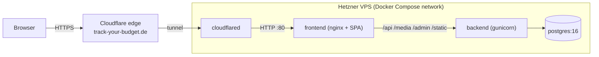

# Temporary deployment on Hetzner Cloud (Docker Compose)

Stop-gap hosting for **Track Your Budget** while the home Kubernetes cluster is
down. One small Hetzner VPS runs the whole stack with Docker Compose and is
exposed through the **same Cloudflare Tunnel mechanism** as the cluster, so:

- no open inbound ports (only SSH), no certificates to manage, TLS is handled by Cloudflare
- the public URL, the OAuth redirect URIs and `FRONTEND_URL` stay exactly as in the cluster
- switching back to the cluster later is a single hostname change in the Cloudflare dashboard



Everything below uses the images the pipeline already publishes to Docker Hub
(`eduardgohl/budget-tracker-backend` and `-frontend`), so nothing is built on
the server.

---

## 1. Total cost

Prices from [hetzner.com/cloud](https://www.hetzner.com/cloud/cost-optimized) as of 2026-10-02.
Hetzner lists them **excl. VAT, incl. IPv4**; a private customer in Germany pays 19 % VAT on top.
Verify the final price in the order summary.

| Item | Net / month | Gross (19 % VAT) / month |
| --- | --- | --- |
| Hetzner **CX23** (2 vCPU x86, 4 GB RAM, 40 GB NVMe, 20 TB traffic, IPv4 included) | 5.99 EUR | **7.13 EUR** |
| Cloudflare Tunnel + DNS + TLS (Free plan) | 0.00 EUR | 0.00 EUR |
| Docker Hub (public images) | 0.00 EUR | 0.00 EUR |
| Hetzner Firewall | 0.00 EUR | 0.00 EUR |
| Domain `track-your-budget.de` | already owned, not part of this deployment | |
| **Total** | **5.99 EUR** | **7.13 EUR** |

- Billing is hourly (CX23: 0.0096 EUR/h net) and capped at the monthly price. Deleting the server stops billing; a merely powered-off server is still billed.
- Realistic temporary use of 2 months: about **14.26 EUR gross**.
- No backups are configured, so the database and avatars live only on this one server; deleting it deletes the data.

### Server choice and availability

The Hetzner cost-optimized servers are sold out regularly; on the date above all types were shown as
"currently unavailable". Order the first type from this list that is available (try Nuremberg and Helsinki):

| Type | Specs | Net / month | Gross / month | Note |
| --- | --- | --- | --- | --- |
| **CX23** (recommended) | 2 vCPU x86, 4 GB, 40 GB | 5.99 EUR | 7.13 EUR | Runs the published x86 images as they are |
| CX33 | 4 vCPU x86, 8 GB, 80 GB | 8.99 EUR | 10.70 EUR | Same, more headroom |
| CAX11 | 2 vCPU **ARM**, 4 GB, 40 GB | 6.49 EUR | 7.72 EUR | Published images are x86; you must build on the server, see [Appendix A](#appendix-a-arm-server-caxxx) |
| CPX12 | 1 vCPU x86, 2 GB, 40 GB | 11.99 EUR | 14.27 EUR | More expensive and only 2 GB; avoid |

Why not smaller: the stack is Postgres + 3 gunicorn workers + nginx + cloudflared, which is roughly 1 to 1.5 GB in use. 4 GB is comfortable; 2 GB works only with swap.

---

## 2. Prerequisites

- Hetzner Cloud account (card or SEPA, ID verification may be requested)
- Cloudflare account that already manages the zone `track-your-budget.de`
- An SSH key pair (`ssh-keygen -t ed25519` if you have none)
- Your production values from the cluster (kept locally in the git-ignored `secrets/*.yaml`):
  `DJANGO_SECRET_KEY`, `POSTGRES_*`, `TYPESAFE_API_KEY`, the three `VITE_*_LINK` URLs
- Optional: a recent `pg_dump` of the production database (see section 6)

---

## 3. Create the server

1. Hetzner Console, **New project**, then **Add server**.
2. Location: Nuremberg, Falkenstein or Helsinki (whichever has stock).
3. Image: **Apps, Docker CE** (Ubuntu with Docker and the Compose plugin preinstalled).
4. Type: **Shared vCPU, Cost-Optimized, CX23**.
5. Networking: public IPv4 enabled (needed to pull from Docker Hub, which has no IPv6), IPv6 optional.
6. SSH key: add your public key. Do not use password login.
7. Firewalls: create a firewall with **one inbound rule: TCP 22** (restrict the source to your own IP if it is static). Leave outbound open; cloudflared needs outbound TCP/UDP 7844 and 443. Attach it to the server.
8. Backups: leave off. Name: `budget-temp`. Create.

---

## 4. Prepare the server

```bash
ssh root@<SERVER_IP>

# non-root user with Docker access
adduser --disabled-password --gecos "" deploy
usermod -aG docker deploy
mkdir -p /home/deploy/.ssh && cp ~/.ssh/authorized_keys /home/deploy/.ssh/
chown -R deploy:deploy /home/deploy/.ssh && chmod 700 /home/deploy/.ssh

# SSH hardening: key only, no root login
sed -i 's/^#\?PermitRootLogin.*/PermitRootLogin no/' /etc/ssh/sshd_config
sed -i 's/^#\?PasswordAuthentication.*/PasswordAuthentication no/' /etc/ssh/sshd_config
systemctl restart ssh

# automatic security updates
apt-get update && apt-get install -y unattended-upgrades
dpkg-reconfigure -plow unattended-upgrades

# optional safety net for a 4 GB box: 2 GB swap
fallocate -l 2G /swapfile && chmod 600 /swapfile && mkswap /swapfile && swapon /swapfile
echo '/swapfile none swap sw 0 0' >> /etc/fstab
exit
```

Log in as `deploy` from now on (keep the root session open until this works):

```bash
ssh deploy@<SERVER_IP>
docker version && docker compose version
```

Docker only publishes ports you list under `ports:`. The compose file below publishes none, so `ufw` is not needed on top of the Hetzner firewall.

---

## 5. Cloudflare Tunnel

The cluster already owns `track-your-budget.de` through its own tunnel. Create a **separate tunnel** for the VPS and move the hostname to it. (Reusing the cluster's token would load-balance requests between the VPS and the cluster once it is back.)

1. Cloudflare dashboard, **Zero Trust, Networks, Tunnels, Create a tunnel**, type **Cloudflared**, name `budget-hetzner`.
2. On the "Install connector" page copy only the **token**: the long string after `--token`. Do not run the shown install command; the token goes into `.env` below.
3. Free the hostname from the old tunnel: open the cluster tunnel, **Public Hostname**, delete the `track-your-budget.de` route. Then in **DNS, Records** delete the `track-your-budget.de` CNAME if it still exists (otherwise Cloudflare reports "record already exists").
4. On `budget-hetzner`, **Public Hostname, Add**:
   - Hostname: `track-your-budget.de` (no subdomain, no path)
   - Service type **HTTP**, URL **`frontend:80`** (the Compose service name; cloudflared runs in the same network)

Cloudflare creates the proxied DNS CNAME automatically.

---

## 6. Deploy files

```bash
sudo mkdir -p /opt/budget && sudo chown -R deploy:deploy /opt/budget
cd /opt/budget
```

### `docker-compose.yml`

```bash
cat > docker-compose.yml <<'EOF'
name: budget

x-logging: &logging
  driver: local
  options:
    max-size: "10m"
    max-file: "3"

services:
  db:
    image: postgres:16-alpine
    restart: unless-stopped
    logging: *logging
    environment:
      POSTGRES_DB: ${POSTGRES_DB}
      POSTGRES_USER: ${POSTGRES_USER}
      POSTGRES_PASSWORD: ${POSTGRES_PASSWORD}
    volumes:
      - postgres_data:/var/lib/postgresql/data
    healthcheck:
      test: ["CMD-SHELL", "pg_isready -U ${POSTGRES_USER} -d ${POSTGRES_DB}"]
      interval: 10s
      timeout: 5s
      retries: 5

  backend:
    image: eduardgohl/budget-tracker-backend:${IMAGE_TAG}
    restart: unless-stopped
    logging: *logging
    environment:
      DJANGO_SECRET_KEY: ${DJANGO_SECRET_KEY}
      DEBUG: "False"
      # "localhost" must stay: the container healthcheck sends Host: localhost.
      ALLOWED_HOSTS: ${DOMAIN},localhost,127.0.0.1
      FRONTEND_URL: https://${DOMAIN}
      # Cloudflare serves HTTPS, so the refresh cookie may be Secure.
      JWT_AUTH_SECURE: "True"
      TYPESAFE_API_KEY: ${TYPESAFE_API_KEY:-}
      POSTGRES_DB: ${POSTGRES_DB}
      POSTGRES_USER: ${POSTGRES_USER}
      POSTGRES_PASSWORD: ${POSTGRES_PASSWORD}
      POSTGRES_HOST: db
      POSTGRES_PORT: "5432"
    volumes:
      - backend_media:/app/media
    depends_on:
      db:
        condition: service_healthy
    command: >
      sh -c "python manage.py migrate --noinput &&
             gunicorn backend.wsgi:application --bind 0.0.0.0:8000 --workers 3"
    healthcheck:
      test: ["CMD", "python", "-c", "import urllib.request; urllib.request.urlopen('http://localhost:8000/api/health/', timeout=3)"]
      interval: 10s
      timeout: 5s
      retries: 6
      start_period: 20s

  frontend:
    image: eduardgohl/budget-tracker-frontend:${IMAGE_TAG}
    restart: unless-stopped
    logging: *logging
    # No "ports:" on purpose: only cloudflared reaches nginx.
    environment:
      VITE_GOOGLE_LINK: ${VITE_GOOGLE_LINK:-}
      VITE_GITHUB_LINK: ${VITE_GITHUB_LINK:-}
      VITE_MICROSOFT_LINK: ${VITE_MICROSOFT_LINK:-}
    depends_on:
      backend:
        condition: service_healthy

  cloudflared:
    image: cloudflare/cloudflared:latest
    restart: unless-stopped
    logging: *logging
    command: tunnel --no-autoupdate run
    environment:
      TUNNEL_TOKEN: ${CLOUDFLARE_TUNNEL_TOKEN}
    depends_on:
      - frontend

volumes:
  postgres_data:
  backend_media:
EOF
```

### `.env`

Use the **same values as the cluster** for `DJANGO_SECRET_KEY`, `POSTGRES_*` and the `VITE_*_LINK` URLs (copy the `VITE_*_LINK` lines from your local `app-manifests/secrets/frontend-secret.yaml`; keep each URL on one line, `&` is fine unquoted in an `.env` file).

```bash
cat > .env <<'EOF'
DOMAIN=track-your-budget.de
IMAGE_TAG=50

DJANGO_SECRET_KEY=<same as in the cluster, or: python3 -c "import secrets; print(secrets.token_urlsafe(64))">
POSTGRES_DB=<db name>
POSTGRES_USER=<db user>
POSTGRES_PASSWORD=<long random password>
TYPESAFE_API_KEY=<key or empty>

VITE_GOOGLE_LINK=<full authorization URL or empty>
VITE_GITHUB_LINK=<full authorization URL or empty>
VITE_MICROSOFT_LINK=<full authorization URL or empty>

CLOUDFLARE_TUNNEL_TOKEN=<token from step 5>
EOF
chmod 600 .env
```

- `IMAGE_TAG`: the tag currently pinned for prod in [app-manifests/overlays/prod/kustomization.yaml](app-manifests/overlays/prod/kustomization.yaml) (`50` at the time of writing). Any build from `main` works.
- If the Docker Hub repositories are private: `docker login -u eduardgohl` (use an access token) before the first pull.
- `FRONTEND_URL` is derived as `https://track-your-budget.de`, identical to the cluster, so the registered OAuth redirect URIs keep working unchanged.

---

## 7. Start the stack

```bash
cd /opt/budget
docker compose config -q          # validates the file and .env substitution
docker compose pull
```

### 7a. With existing data (recommended if you have a dump)

If you still have a `pg_dump -Fc` file of the production database, copy it over and restore **before** the backend starts:

```bash
# from your workstation
scp budget.dump deploy@<SERVER_IP>:/opt/budget/

# on the server
docker compose up -d db
docker compose exec -T db pg_restore -U "$(grep ^POSTGRES_USER .env | cut -d= -f2)" \
  -d "$(grep ^POSTGRES_DB .env | cut -d= -f2)" --no-owner --clean --if-exists < budget.dump
docker compose up -d
```

The dump also contains the allauth `SocialApp` rows (Google/GitHub/Microsoft client IDs and secrets live in the database, not in env vars), so social login works right away.

### 7b. Fresh start (no dump)

```bash
docker compose up -d
docker compose exec backend python manage.py createsuperuser
```

Then sign in at `https://track-your-budget.de/admin/` and, under **Social applications**, re-create the Google / GitHub / Microsoft apps (client ID and secret from the provider consoles) and assign the site `example.com` (Sites, ID 1) to each. Without this, social login fails server-side.

### Avatars (optional)

Provider avatars live in the `backend_media` volume. If they are retrievable from the old server's `media/` directory, copy them in:

```bash
docker compose cp ./media/. backend:/app/media/
```

Otherwise they are simply missing; the UI falls back to default avatars.

---

## 8. Verify

```bash
docker compose ps                                   # all "healthy" / "running"
docker compose logs --tail 30 cloudflared           # expect "Registered tunnel connection"
docker compose exec frontend wget -qO- http://localhost/api/health/
```

Then open `https://track-your-budget.de`, log in with a provider, create a transaction, reload, and upload/see an avatar. In the Cloudflare tunnel overview the connector must show **Healthy**.

---

## 9. Update to a new version

The Azure pipeline does not deploy to this server. After a successful `main` build:

```bash
cd /opt/budget
sed -i 's/^IMAGE_TAG=.*/IMAGE_TAG=<new build id>/' .env
docker compose pull && docker compose up -d
docker image prune -f
```

Migrations run automatically on backend start.

---

## 10. Switch back to the home cluster

1. Bring the cluster up and confirm the app works through its own tunnel (or temporarily via Traefik).
2. Only if data created on the VPS should be kept: dump it once (`docker compose exec -T db pg_dump -U <user> -Fc <db> > budget.dump`), restore it into the host Postgres (`pg_restore --clean --if-exists`), and copy `/app/media` into the `backend-media` PVC. Otherwise skip this step.
3. Cloudflare Zero Trust, Tunnels: delete the `track-your-budget.de` public hostname from `budget-hetzner` (and its DNS CNAME), then add it again to the cluster tunnel (`http://traefik.kube-system.svc.cluster.local:80`).
4. Check `https://track-your-budget.de` against the cluster.
5. Hetzner Console: **delete** the server (and the firewall, and any snapshots). Billing ends with deletion. Delete the `budget-hetzner` tunnel.

---

## 11. Troubleshooting

| Symptom | Cause / fix |
| --- | --- |
| Cloudflare error 1033 | Tunnel not connected or hostname route missing. Check `docker compose logs cloudflared` and the token. |
| Cloudflare error 502 | Route URL is wrong (must be `frontend:80`, HTTP), or frontend is not running. `docker compose ps`. |
| `Unauthorized: Tunnel not found` / `Provided Tunnel token is not valid` | Token from a deleted tunnel, or pasted with whitespace/line break. Re-copy it into `.env` on one line. |
| "record already exists" when adding the hostname | Delete the old CNAME for `track-your-budget.de` in Cloudflare DNS first (step 5.3). |
| Browser 400 "Bad Request (400)" | `DOMAIN` in `.env` does not match the hostname you open; Django `ALLOWED_HOSTS` rejects it. |
| Login works but refresh/session drops immediately | Opened via plain HTTP; `JWT_AUTH_SECURE=True` needs HTTPS (always use the Cloudflare URL). |
| Social login: redirect/`redirect_uri_mismatch` | `FRONTEND_URL` and the `redirect_uri` in each `VITE_*_LINK` must be identical and registered at the provider. |
| Social login fails server-side after redirect | `SocialApp` rows missing (fresh DB). See 7b. |
| Admin POST gives CSRF error | `FRONTEND_URL` must be the `https://` origin; Cloudflare must forward `X-Forwarded-Proto` (it does by default). |
| Backend container restarts | `docker compose logs backend`; usually wrong `POSTGRES_*` or a missing `DJANGO_SECRET_KEY`. |
| `no matching manifest for linux/arm64` | You ordered an ARM server (CAX). Use a CX type or Appendix A. |
| Out of memory | Add swap (section 4) or lower `--workers 3` to `2` in the backend `command`. |

---

## Appendix A: ARM server (CAX11)

CAX types are about 8 % more expensive than CX23 and the pipeline only publishes x86 images, so build natively on the server. Clone the app repo and use its own compose file, which already has `build:` sections, with the deployment values from section 6:

```bash
git clone https://github.com/Track-Your-Budget/budget-tracker-app.git /opt/budget/app
cd /opt/budget/app/track-your-budget
```

Then replace the two `image:` lines in the compose file from section 6 with
`build: { context: /opt/budget/app/track-your-budget/backend }` and `.../app-frontend`, and run `docker compose up -d --build`. The first build takes a few minutes and about 1 GB of extra disk.

## Appendix B: Without Cloudflare (Caddy, open ports)

Not recommended here, since the Cloudflare route needs no open ports and no certificates. If Cloudflare is unavailable: open TCP 80 and 443 in the Hetzner firewall, point an `A` record at the server IP, add a `caddy:2` service with `ports: ["80:80","443:443"]` and a `Caddyfile` containing `track-your-budget.de { reverse_proxy frontend:80 }`, and remove the `cloudflared` service. Caddy obtains the Let's Encrypt certificate itself. Costs are identical.
